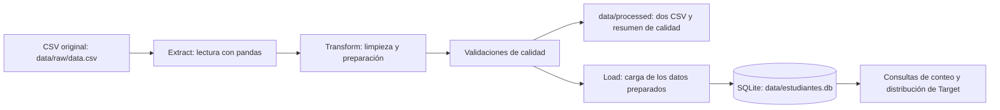
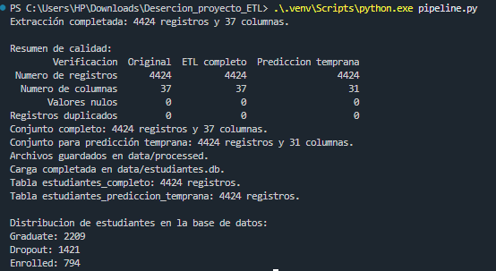

# Predicción del Rendimiento Académico y Riesgo de Deserción en Estudiantes de Educación Superior

Curso: ETL - Maestría en Inteligencia Artificial y Ciencia de Datos, Universidad Autónoma de Occidente  

## Integrantes

#### Rubén Darío Salcedo Ramírez (22607750)
#### Isabella Quintero Cambindo (22608480)
#### Daniel Fernando Mejia Mendoza (22607764)

## Tabla de contenido

- [Predicción del Rendimiento Académico y Riesgo de Deserción en Estudiantes de Educación Superior](#predicción-del-rendimiento-académico-y-riesgo-de-deserción-en-estudiantes-de-educación-superior)
  - [Integrantes](#integrantes)
      - [Rubén Darío Salcedo Ramírez (22607750)](#rubén-darío-salcedo-ramírez-22607750)
      - [Isabella Quintero Cambindo (22608480)](#isabella-quintero-cambindo-22608480)
      - [Daniel Fernando Mejia Mendoza (22607764)](#daniel-fernando-mejia-mendoza-22607764)
  - [Tabla de contenido](#tabla-de-contenido)
  - [1. Descripción del problema](#1-descripción-del-problema)
  - [2. Fuentes de datos](#2-fuentes-de-datos)
  - [3. Arquitectura del pipeline](#3-arquitectura-del-pipeline)
  - [4. Estructura del repositorio](#4-estructura-del-repositorio)
  - [5. Requisitos](#5-requisitos)
  - [6. Instalación y configuración](#6-instalación-y-configuración)
    - [Obtener el proyecto](#obtener-el-proyecto)
    - [Crear el entorno e instalar las dependencias](#crear-el-entorno-e-instalar-las-dependencias)
    - [Variables de entorno](#variables-de-entorno)
    - [Obtención de los datos](#obtención-de-los-datos)
  - [7. Ejecución](#7-ejecución)
    - [Tiempo de ejecución](#tiempo-de-ejecución)
    - [Salida esperada](#salida-esperada)
  - [8. Detalle de las etapas ETL](#8-detalle-de-las-etapas-etl)
    - [8.1 Extract](#81-extract)
    - [8.2 Transform](#82-transform)
    - [8.3 Load](#83-load)
  - [9. Modelo y diccionario de datos](#9-modelo-y-diccionario-de-datos)
  - [10. Calidad de datos y validaciones](#10-calidad-de-datos-y-validaciones)
    - [Resultados de la ejecución](#resultados-de-la-ejecución)
    - [Reglas que detienen la ejecución si no se cumplen](#reglas-que-detienen-la-ejecución-si-no-se-cumplen)
    - [Comprobación de la carga](#comprobación-de-la-carga)
  - [11. Resultados](#11-resultados)
    - [Consulta sobre los datos cargados](#consulta-sobre-los-datos-cargados)
    - [Evidencia de ejecución](#evidencia-de-ejecución)
  - [12. Limitaciones y trabajo futuro](#12-limitaciones-y-trabajo-futuro)
    - [Limitaciones](#limitaciones)
    - [Trabajo futuro](#trabajo-futuro)
  - [13. Referencias](#13-referencias)
  - [Declaración de uso de IA](#declaración-de-uso-de-ia)
    - [Uso de inteligencia artificial generativa](#uso-de-inteligencia-artificial-generativa)

## 1. Descripción del problema

Las instituciones de educación superior necesitan analizar los factores
relacionados con el rendimiento académico y la permanencia estudiantil.
La información académica, demográfica y socioeconómica puede apoyar
la identificación de perfiles asociados con la deserción, siempre que
esté organizada y preparada para su análisis.

Este proyecto se desarrolla mediante un pipeline ETL sobre el conjunto 
Predict Students' Dropout and Academic Success de UCI. 
Los datos resultantes están destinados a análisis que podrían apoyar a 
coordinadores académicos y equipos de acompañamiento
estudiantil. El escenario definido utiliza información hasta el cierre
del primer semestre; esta entrega prepara los datos, pero no entrena
ni evalúa un modelo predictivo.

**Objetivo:** disponer de datos documentados y validados en una base
SQLite, conservando un conjunto completo y otro que excluye las variables
del segundo semestre para su posterior uso en análisis y clasificación
del resultado académico.

## 2. Fuentes de datos

| Fuente | Tipo | Origen / URL | Tamaño aproximado | Frecuencia de actualización |
|---|---|---|---|---|
| Predict Students' Dropout and Academic Success | CSV separado por punto y coma | [UCI Machine Learning Repository](https://archive.ics.uci.edu/dataset/697/predict+students+dropout+and+academic+success) | 4.424 filas y 37 columnas | Se utiliza una copia estática; el pipeline no consulta actualizaciones | 

Licencia del dataset: Creative Commons Attribution 4.0 International
(CC BY 4.0). La referencia de sus autores se incluye en la sección 13.

El archivo original es conservado en data/raw/data.csv.
Contiene 36 características y la variable objetivo Target.

## 3. Arquitectura del pipeline



La extracción lee el CSV local sin modificarlo.
La transformación limpia encabezados, identifica categorías y genera
el conjunto para predicción temprana.
Antes de exportar y cargar, se ejecutan las validaciones implementadas.
SQLite permite almacenar y consultar los resultados sin instalar un servidor.
La carga reemplaza las dos tablas en cada ejecución para no acumular registros.

Tecnologías usadas: Python 3.12.4, pandas 2.2.3 y SQLite mediante
el módulo sqlite3 incluido con Python.


## 4. Estructura del repositorio

La siguiente estructura muestra el proyecto después de ejecutar el pipeline.
La carpeta data/processed/ y el archivo data/estudiantes.db se generan
automáticamente y no están incluidos en el repositorio.

```text
├── data/
│   ├── raw/
│   │   └── data.csv
│   ├── processed/
│   │   ├── data_etl_clean.csv
│   │   ├── data_prediccion_temprana.csv
│   │   └── resumen_calidad.csv
│   └── estudiantes.db
├── docs/
│   ├── diccionario_datos.md
│   └── evidencia_ejecucion.png
├── extract/
│   └── extract_data.py
├── transform/
│   ├── transform_data.py
│   └── validar_datos.py
├── load/
│   └── load_data.py
├── pipeline.py
├── requirements.txt
├── .gitignore
└── README.md
```

- `data/raw/`: archivo original, sin modificar.
- `data/processed/`: conjuntos preparados y resumen de calidad.
- `data/estudiantes.db`: base SQLite generada por el pipeline.
- `docs/`: diccionario de datos y evidencia de ejecución.
- `extract/`: lectura del archivo original.
- `transform/`: preparación y validación de los datos.
- `load/`: carga de los conjuntos en SQLite.
- `pipeline.py`: coordina las etapas y consulta los resultados cargados.

## 5. Requisitos

- Python 3.12.4, versión utilizada para desarrollar y ejecutar el proyecto.
- pandas 2.2.3, incluido en requirements.txt.
- El archivo original ubicado en data/raw/data.csv.

SQLite se utiliza mediante sqlite3, incluido con Python.
No se necesita instalar un servidor de base de datos.

## 6. Instalación y configuración

### Obtener el proyecto

Descargue el repositorio desde GitHub mediante **Code → Download ZIP**
y descomprímalo, o clónelo usando su URL.

Abra una terminal en la carpeta que contiene pipeline.py.

### Crear el entorno e instalar las dependencias

En Windows, ejecute:

```powershell
python -m venv .venv
.\.venv\Scripts\python.exe -m pip install -r requirements.txt
```

Si aparece el error "No module named pip", ejecute:

```powershell
.\.venv\Scripts\python.exe -m ensurepip --upgrade
.\.venv\Scripts\python.exe -m pip install -r requirements.txt
```

Los comandos utilizan directamente el Python del entorno virtual,
por lo que no es necesario activarlo.

### Variables de entorno

Este proyecto no requiere credenciales ni variables de entorno.
La base SQLite se guarda localmente; no se necesita un archivo .env.

### Obtención de los datos

El archivo original se incluye en data/raw/data.csv.

También puede obtenerse desde la
[página del dataset en UCI](https://archive.ics.uci.edu/dataset/697/predict+students+dropout+and+academic+success):
descargue el conjunto, descomprima el archivo y copie data.csv
en data/raw/, conservando su nombre y contenido.


## 7. Ejecución

Desde la carpeta principal del proyecto, ejecute:

```powershell
.\.venv\Scripts\python.exe pipeline.py
```

Si el entorno virtual ya está activado, puede ejecutar:

```powershell
python pipeline.py
```
### Tiempo de ejecución

En la prueba realizada desde una copia nueva de la rama develop,
con un entorno virtual recién creado, el pipeline se ejecutó
completamente en aproximadamente 6,26 segundos.

Este tiempo corresponde a una ejecución local, no incluye la instalación
de dependencias y puede variar según el equipo.


### Salida esperada

El pipeline genera:

| Salida | Ubicación | Contenido |
|---|---|---|
| Conjunto completo | `data/processed/data_etl_clean.csv` | 4.424 registros y 37 columnas |
| Conjunto temprano | `data/processed/data_prediccion_temprana.csv` | 4.424 registros y 31 columnas |
| Resumen de calidad | `data/processed/resumen_calidad.csv` | Comparación de dimensiones, nulos y duplicados |
| Base de datos | `data/estudiantes.db` | Dos tablas con los conjuntos preparados |

La terminal muestra el resumen de calidad, el número de registros
cargados en cada tabla y la distribución de Target:

```text
Graduate: 2209
Dropout: 1421
Enrolled: 794
```

Las nuevas ejecuciones sobrescriben los archivos procesados y reemplazan
las tablas de destino. El CSV original permanece sin modificaciones.

## 8. Detalle de las etapas ETL

### 8.1 Extract

- Qué hace: lee el CSV original con pandas, utilizando punto y coma como separador.
- Script: extract/extract_data.py.
- Entrada: data/raw/data.csv.
- Salida: un DataFrame con 4.424 registros y 37 columnas, utilizado por la etapa de transformación.

La extracción utiliza el archivo local y no modifica su contenido.

### 8.2 Transform

- Qué hace: prepara los conjuntos completo y de predicción temprana.
- Scripts: transform/transform_data.py y transform/validar_datos.py.
- Salidas: data/processed/data_etl_clean.csv, data/processed/data_prediccion_temprana.csv y data/processed/resumen_calidad.csv.

| # | Transformación | Justificación |
|---|---|---|
| 1 | Crear una copia del DataFrame original | Conservar los datos originales durante la preparación. |
| 2 | Eliminar espacios y tabulaciones en los extremos de los encabezados | Evitar problemas al seleccionar columnas. |
| 3 | Convertir las variables categóricas a category en pandas | Distinguir los códigos de categorías de las cantidades numéricas. |
| 4 | Identificar Target como variable categórica | Representar los tres resultados académicos que se analizarán. |
| 5 | Excluir las seis variables del segundo semestre del conjunto temprano | No utilizar información del segundo semestre en el escenario de predicción al cierre del primero. |

Las transformaciones retoman las decisiones de la Entrega 2.
No se aplican imputaciones ni eliminación de registros, dado que el archivo
analizado no presenta valores nulos ni filas duplicadas exactas.

El conjunto completo conserva las 37 columnas.
El conjunto temprano contiene 30 variables predictoras y Target,
para un total de 31 columnas.

La conversión a category corresponde al procesamiento en pandas.
Al exportar a CSV y cargar en SQLite, se conservan los valores;
su significado categórico queda documentado en el diccionario.

### 8.3 Load

- Qué hace: carga los dos conjuntos preparados como tablas de SQLite.
- Script: load/load_data.py.
- Destino: data/estudiantes.db.
- Modo de carga: reemplazo completo mediante if_exists="replace".

| Tabla | Registros | Columnas |
|---|---:|---:|
| estudiantes_completo | 4424 | 37 |
| estudiantes_prediccion_temprana | 4424 | 31 |

La base se crea si no existe.
En cada ejecución se reemplazan las tablas, evitando acumular registros
de ejecuciones anteriores.

El índice de pandas no se guarda como columna adicional.
Después de la carga, el pipeline consulta el número de registros
de ambas tablas y la distribución de Target en la tabla temprana.

## 9. Modelo y diccionario de datos

Se utiliza un modelo tabular con dos tablas.
Cada fila representa un estudiante.

estudiantes_completo conserva todas las variables del conjunto preparado.
estudiantes_prediccion_temprana contiene la versión que excluye
las seis variables del segundo semestre.

Las tablas no tienen relaciones ni claves primarias definidas.
No se implementa un modelo dimensional, porque el producto de este
pipeline son conjuntos tabulares destinados a análisis posterior.

El detalle de las columnas, sus tipos de almacenamiento, descripciones
y ejemplos está disponible en el
[diccionario de datos](docs/diccionario_datos.md).

## 10. Calidad de datos y validaciones

El pipeline genera un resumen que compara los datos originales
con los dos conjuntos preparados.

### Resultados de la ejecución

| Verificación | Original | ETL completo | Predicción temprana |
|---|---:|---:|---:|
| Número de registros | 4424 | 4424 | 4424 |
| Número de columnas | 37 | 37 | 31 |
| Valores nulos | 0 | 0 | 0 |
| Filas duplicadas exactas | 0 | 0 | 0 |

Estos resultados se guardan en
"data/processed/resumen_calidad.csv".

### Reglas que detienen la ejecución si no se cumplen

| Regla | Criterio |
|---|---|
| Conservación de registros | Los tres conjuntos deben tener el mismo número de filas. |
| Categorías de Target | Todos los valores deben ser Graduate, Dropout o Enrolled, sin nulos. |
| Cantidades de unidades curriculares | Las columnas de cantidades deben tener valores mayores o iguales a cero y no nulos. Esta regla no incluye las columnas de calificaciones. |
| Exclusión del segundo semestre | Ninguna columna del conjunto temprano debe contener 2nd sem en su nombre. |

Los conteos de nulos generales y duplicados se reportan en el resumen;
por sí solos no detienen la ejecución.

### Comprobación de la carga

Se consulta directamente SQLite mediante SELECT COUNT(*).
La ejecución realizada mostró 4.424 registros en cada tabla,
coincidiendo con los conjuntos preparados.

Estas verificaciones cubren estructura, categorías y algunas reglas
de consistencia. No equivalen a validar todos los códigos categóricos,
rangos y relaciones posibles del dataset.

## 11. Resultados

El pipeline ejecutó las etapas de extracción, transformación y carga
sobre los 4.424 registros del archivo original.

Se generaron dos conjuntos de datos y se cargaron en SQLite:

- Un conjunto completo con 37 columnas.
- Un conjunto para predicción temprana con 31 columnas.

Ambos conservaron los 4.424 registros, sin valores nulos ni filas
duplicadas exactas en la ejecución realizada.
También se generó el archivo data/processed/resumen_calidad.csv.

### Consulta sobre los datos cargados

La siguiente consulta permite revisar la distribución del resultado
académico en la tabla destinada a predicción temprana:

```sql
SELECT Target, COUNT(*) AS cantidad
FROM estudiantes_prediccion_temprana
GROUP BY Target
ORDER BY cantidad DESC;
```

| Target | Cantidad |
|---|---:|
| Graduate | 2209 |
| Dropout | 1421 |
| Enrolled | 794 |
| **Total** | **4424** |

La distribución coincide con la del conjunto original.

### Evidencia de ejecución

La captura muestra la extracción, el resumen de calidad, los conteos
consultados en SQLite y la distribución de Target.



El resultado de esta entrega es un pipeline ETL y sus datos preparados.
No se presentan métricas predictivas, porque no se entrenó un modelo
de clasificación.

## 12. Limitaciones y trabajo futuro

### Limitaciones

- Se utiliza una sola fuente y una copia estática del dataset.
  La extracción requiere que el archivo esté disponible localmente.
- Las validaciones implementadas no comprueban todos los códigos
  categóricos ni todas las relaciones posibles entre variables.
- La ausencia de nulos no garantiza que toda la información sea conocida:
  algunos códigos categóricos pueden representar información desconocida.
- La exclusión del segundo semestre evita utilizar esas variables,
  pero no demuestra por sí sola que todas las demás estuvieran disponibles
  al cierre del primer semestre.
- El conjunto proviene de una institución de educación superior de Portugal.
  Su aplicación a otras instituciones requiere evaluar las diferencias
  de contexto y población.
- La carga reemplaza las tablas completas; no conserva un historial
  de versiones ni implementa carga incremental.
- No se entrena un modelo ni se evalúa su capacidad para identificar
  estudiantes en riesgo.

### Trabajo futuro

- Ampliar las validaciones a los dominios categóricos y reglas
  de consistencia documentadas por la fuente.
- Revisar la disponibilidad temporal de cada variable antes de
  utilizarla en un modelo de predicción temprana.
- Automatizar la descarga del archivo si se requiere actualizar
  la fuente utilizada.
- Evaluar posteriormente modelos de clasificación, considerando
  la distribución desigual de las clases y separando los datos
  de entrenamiento y evaluación.

## 13. Referencias

- Realinho, V., Vieira Martins, M., Machado, J., y Baptista, L. (2021).
  *Predict Students' Dropout and Academic Success* [Dataset].
  UCI Machine Learning Repository.
  https://doi.org/10.24432/C5MC89

- [Documentación y catálogo de variables del dataset en UCI](https://archive.ics.uci.edu/dataset/697/predict+students+dropout+and+academic+success).

- [Documentación de pandas](https://pandas.pydata.org/docs/).

- [Documentación de sqlite3 en Python 3.12](https://docs.python.org/3.12/library/sqlite3.html).


## Declaración de uso de IA

### Uso de inteligencia artificial generativa

Se utilizó ChatGPT/Codex como herramienta de apoyo durante la preparación de esta entrega. Su participación incluyó la revisión de la consigna y de los avances anteriores, la reorganización del código de la Entrega 2 en módulos, la resolución de errores de configuración y el acompañamiento en el uso de Git y GitHub. También apoyó la redacción del README y del diccionario de datos.
